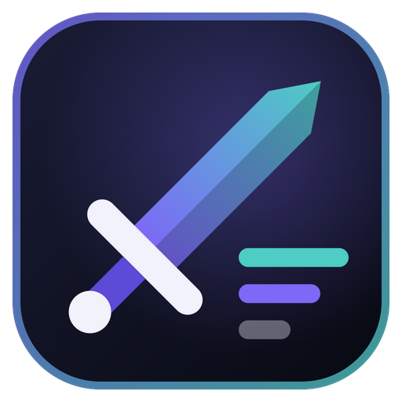
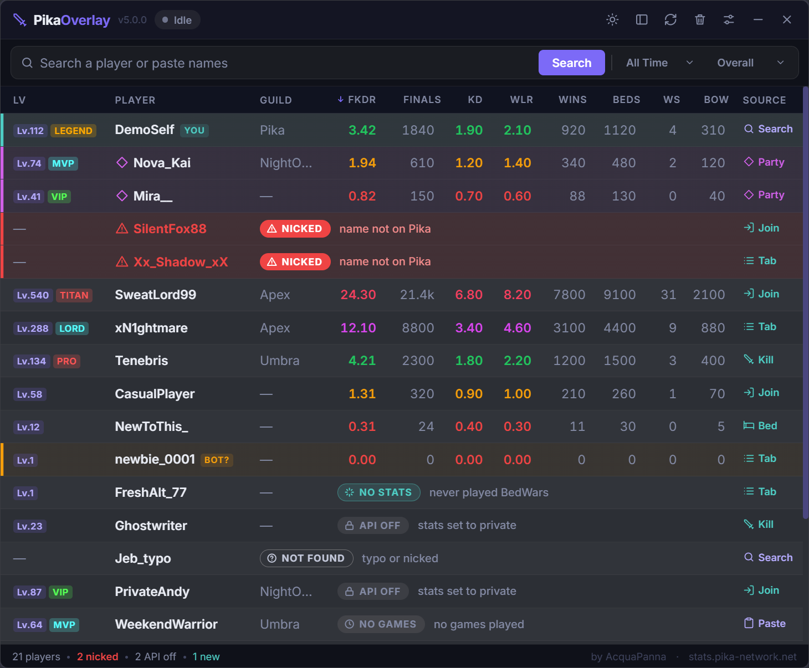
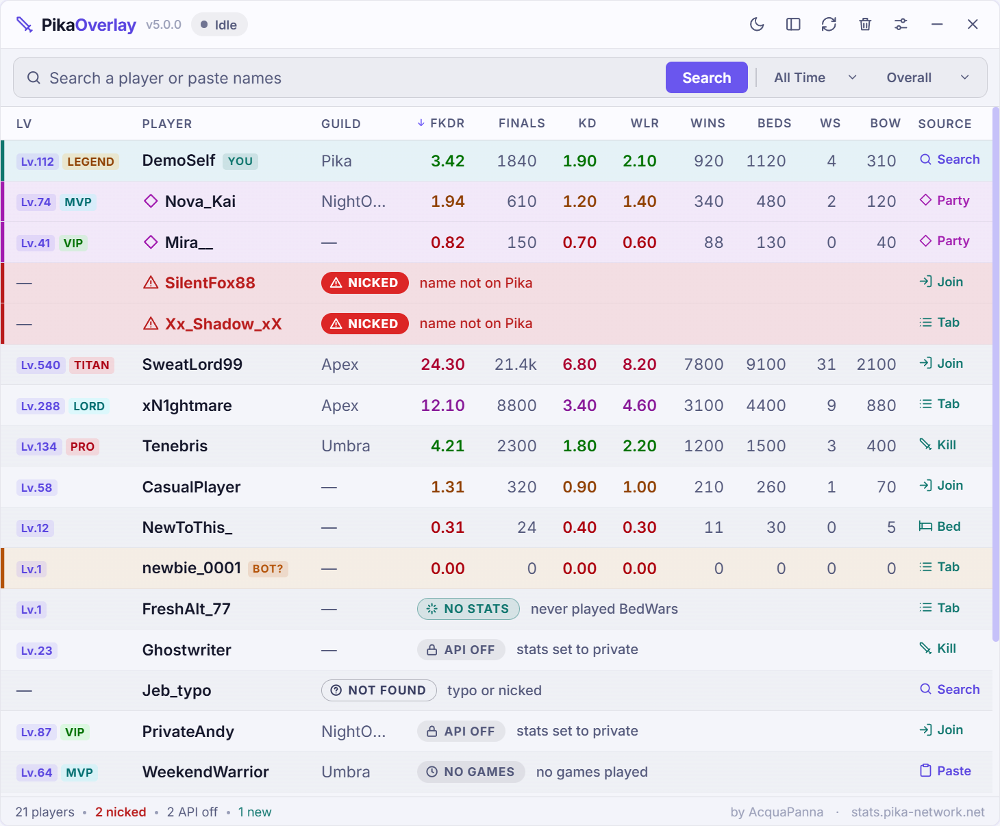
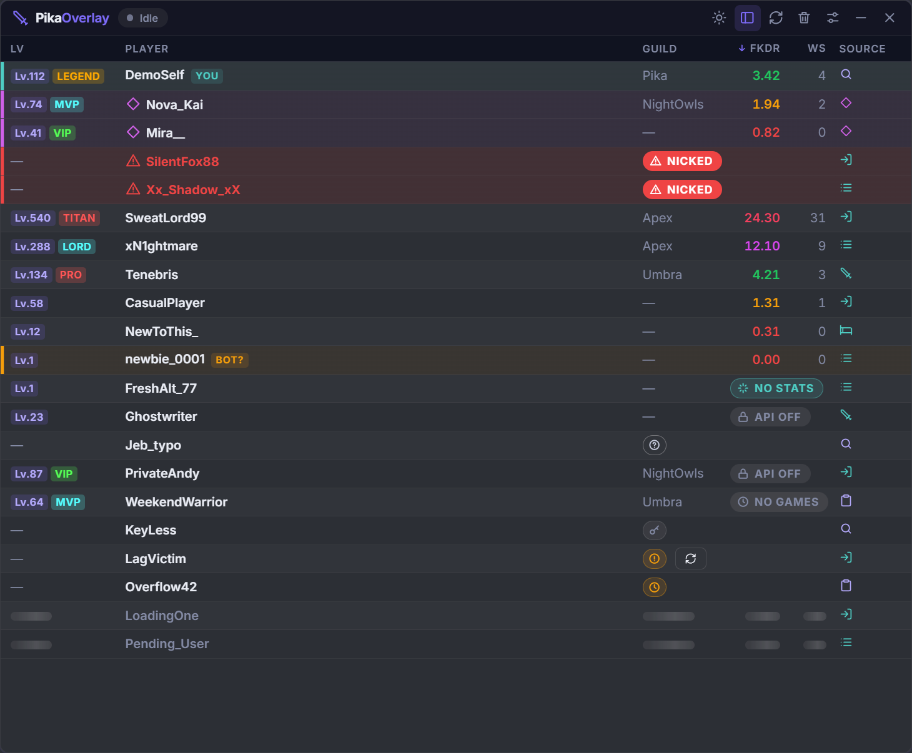
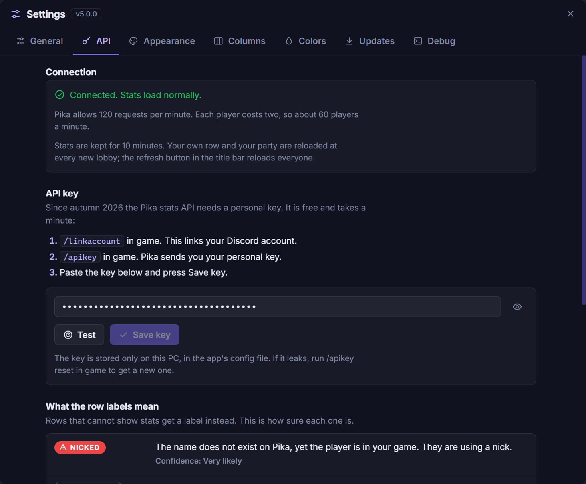

<p align="center">
  
</p>

<h1 align="center">Pika Overlay</h1>

<p align="center">
  A BedWars stats overlay for <a href="https://www.pika-network.net">Pika-Network</a>.<br>
  See who you are queued with before the match starts: FKDR, wins, winstreak, nicked players and private profiles.
</p>

<p align="center">
  <a href="https://github.com/Krovus7/pika-overlay/releases/latest"></a>
  
  
</p>

<p align="center">
  
</p>

## What it does

Pika Overlay sits on top of Minecraft as a transparent, always-on-top window.
It reads the game's `latest.log`, picks up the players of your lobby and shows
their BedWars stats from the official Pika stats API.

- **Automatic detection.** Players are found from lobby joins, the tab list,
  the kill feed, bed breaks and team tags. Nothing to type.
- **The table follows the lobby.** It fills while you wait, stays during the
  match, drops players who are eliminated and empties when you move on.
- **Honest labels instead of guesses.** A player without stats is labelled
  with the reason: nicked, private profile, never played, no games this week.
- **Party aware.** Party members are pinned on top and their stats, like your
  own, are reloaded at every new lobby.
- **Readable on any background.** Dark and light themes, and a legibility
  floor that keeps text readable down to 5 % background opacity.
- **Within the API limit.** A 10-minute cache and a rate limiter keep the
  overlay inside Pika's 120 requests per minute.

| Light theme | Compact layout |
|---|---|
|  |  |

## Install

1. Download `pika-overlay-win-Setup.exe` from the
   [latest release](https://github.com/Krovus7/pika-overlay/releases/latest)
   and run it. A portable zip is attached to the same release.
2. Start **Pika Overlay** from the Start menu.

Windows 10 or 11. The app updates itself: Settings → Updates checks for a new
version at startup and installs it when you press **Update and restart**.

## First run

Three things, once:

1. **API key.** Pika's stats API needs a personal key (free, one minute):
   - in game, run `/linkaccount` and link your Discord account;
   - run `/apikey`; Pika sends you the key;
   - open Settings → **API**, paste it and press **Save key**.
2. **Log file.** Settings → **General** → Browse, and pick the `latest.log` of
   the client you play with (the vanilla launcher, Lunar, Badlion and others
   each keep their own). The field shows whether the file was found.
3. **Your username.** Settings → **General** → My username, so the overlay
   knows which row is yours and when you enter a new lobby.

<p align="center">
  
</p>

The key is stored only on your PC, in `%APPDATA%\pika-overlay\config.json`.
If it leaks, `/apikey reset` in game replaces it.

## Using it

Join a BedWars queue and the table fills by itself. You can also type or paste
names into the search box (several at once, separated by spaces or commas).

| Label | Meaning |
|---|---|
| *(stats)* | Public profile with BedWars data for the selected period and mode |
| **NICKED** | The name is in your game but does not exist on Pika: the player is using a nick |
| **NOT FOUND** | A name you typed that does not exist on Pika (a typo, or a nick) |
| **API OFF** | The player set their stats to private |
| **NO STATS** | Public profile that never played BedWars |
| **NO GAMES** | Has BedWars stats, but none in the selected period or mode |
| **ERROR** / **RATE LIMITED** | The lookup failed or has to wait; retried automatically |
| **KEY REQUIRED** | No API key saved, or the key was rejected |

- **Period and mode:** All Time, Weekly, Monthly, Yearly; Overall, Solo, Duo,
  Triples, Quad.
- **Sorting:** click a column header. Your own row, your party and nicked
  players can be kept on top.
- **Title bar:** theme, layout (detailed or compact), refresh (reload every
  row, ignoring the cache), clear, settings.
- **Hotkeys:** `F4` show or hide, `F5` clear. Both can be changed in
  Settings → General.
- **Playing nicked yourself:** tick "I am nicked" and enter your nick, so the
  overlay still recognises your own row.

### Settings

| Tab | What is there |
|---|---|
| General | log file, username, nick, hotkeys |
| API | connection status, API key, what each label means |
| Appearance | theme, background opacity, interface scale, layout, row density, always on top |
| Columns | show, hide and reorder columns; choose the columns of the compact layout |
| Colors | tier colors and thresholds for FKDR, KD and WLR |
| Updates | installed version, check and install updates |
| Debug | connection state and the most recent log lines |

Every setting saves as you change it.

## Privacy

- The overlay reads one local file, the Minecraft log you selected. It does
  not read game memory, inject into the game or send anything to the server.
- It sends player names to `stats.pika-network.net`, with your API key, to
  fetch their stats, and it contacts GitHub to check for updates. Nothing else
  leaves your PC.
- This is a fan project, not affiliated with or endorsed by Pika-Network.
  Check the server's rules before using third-party tools.

## Troubleshooting

| Problem | Try |
|---|---|
| Banner "Pika API key required" or "API key rejected" | Run `/apikey` in game again and save the key in Settings → API. **Test** checks a key without saving it. |
| No players appear | Settings → General: the log file must show as found and belong to the client you are playing on; check your username. |
| Many rows say RATE LIMITED | Pika allows 120 requests per minute per key. The overlay waits and resumes by itself. |
| The overlay is hidden behind the game | Turn on "Always on top" in Settings → Appearance; exclusive fullscreen can still cover it, borderless or windowed mode does not. |
| The app does not start from a terminal | Start it from the Start menu. A shell with `ELECTRON_RUN_AS_NODE=1` set makes Electron apps exit at once. |

## Development

Electron and TypeScript, bundled with esbuild, tested with `node:test`.
Requires Node.js 20 or newer.

```
npm install
npm run build        # esbuild (renderer + preload) + tsc (main, tests)
start.bat            # clears ELECTRON_RUN_AS_NODE, then launches Electron
```

```
npm run typecheck && npm test     # type checks and the unit tests
npm run pack                      # Setup.exe, portable zip and update feed (Velopack)
npm run release                   # pack + upload to GitHub Releases (needs GITHUB_TOKEN)
```

Verification scripts (details in [`docs/TESTING.md`](docs/TESTING.md)):

```
node scripts/smoke.mjs               # drives the real app over CDP, with live lookups
node scripts/live-api-check.mjs      # checks the status classification against the real API
node scripts/replay-logs.mjs         # real logs through the parser vs the frozen v3 parser
node scripts/simulate-session.mjs    # replays real logs through the whole pipeline in virtual time
node scripts/replay-live.mjs <log>   # feeds a real log to the running app with the live API
```

Scripts read the API key only from the `PIKA_API_KEY` environment variable.
Never commit a key.

### Documentation

| Doc | Content |
|---|---|
| [`docs/ARCHITECTURE.md`](docs/ARCHITECTURE.md) | module map, data flow, invariants |
| [`docs/FUNCTIONALITY.md`](docs/FUNCTIONALITY.md) | user-visible behavior, statuses, settings |
| [`docs/STATE-AND-IPC.md`](docs/STATE-AND-IPC.md) | state owners, IPC channels and events |
| [`docs/API-CLIENT.md`](docs/API-CLIENT.md) | API facts, status classification, rate budget, caches |
| [`docs/LOG-PARSING.md`](docs/LOG-PARSING.md) | log parser contract |
| [`docs/TESTING.md`](docs/TESTING.md) | test suites, scripts, gates |
| [`docs/RELEASING.md`](docs/RELEASING.md) | pack, publish, update-cycle checks |
| [`docs/VERIFICATION-2026-11.md`](docs/VERIFICATION-2026-11.md) | what was verified for v5, how, and what was not |
| [`docs/adr/`](docs/adr/README.md) | architecture decision records |

Project rules for contributors and coding agents are in `AGENTS.md`,
`REGOLE.md` and `METODO.md` (Italian).

### Verification status

v5 is verified by unit tests, a simulation over 55 real game logs, replays of
real logs into the running app and smoke runs against the live API. A full
live BedWars session and the in-app update from 4.1.0 to 5.0.0 are not yet
field-verified. The record is
[`docs/VERIFICATION-2026-11.md`](docs/VERIFICATION-2026-11.md).

## Credits

Made by **AcquaPanna**. Stats from
[stats.pika-network.net](https://stats.pika-network.net). ISC license.
